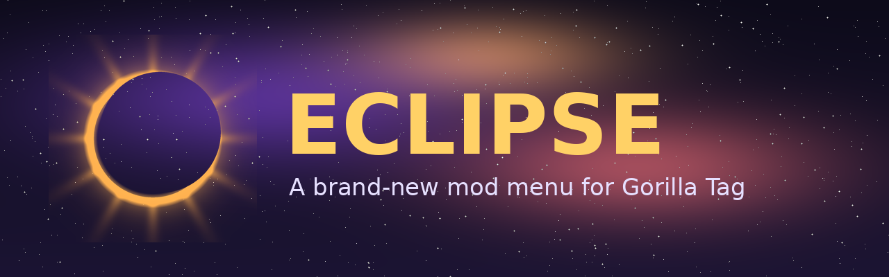
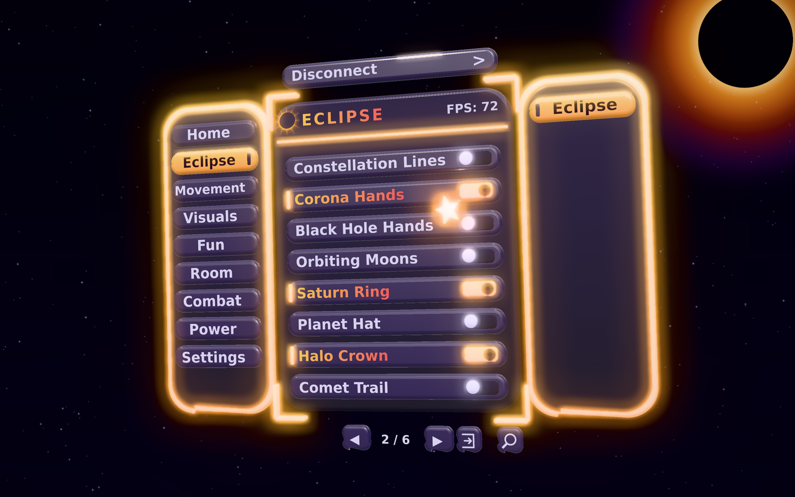

# Eclipse Menu

A brand-new mod menu for Gorilla Tag, remade from [Nova Menu](https://github.com/HZMGTX/Nova) with its own 3D menu, layouts, themes, sounds and mods.

 A render of the Eclipse Panel layout

## Install

1. Install [BepInEx 5](https://github.com/BepInEx/BepInEx/releases) for Gorilla Tag.
2. Download `Eclipse.Menu.dll` from the [latest release](https://github.com/HZMGTX/Eclipse-Menu/releases/latest).
3. Put it in `Gorilla Tag/BepInEx/plugins`.
4. **Remove `Nova Menu.dll` if you have it.** Eclipse and Nova change the same parts of the game, so Eclipse won't start while Nova is installed.

| File | What it is |
|---|---|
| `Eclipse.Menu.dll` | The full menu |
| `Eclipse.Menu.Legal.dll` | Only the mods that give no advantage (visuals, settings and tools) |
| `Eclipse.Menu.Debug.dll`, `Eclipse.Menu.Legal.Debug.dll` | The same two with extra logging, for reporting bugs |

Eclipse keeps its settings in its own `EclipseMenu` folder, so it never touches your Nova settings. The PC menu key is **Q**, the same as Nova.

## What's new in Eclipse

### A new 3D menu
Every part of the menu is a rounded tile with a bevelled edge, the tiles are shiny, the rims, corners and switched-on mods glow, buttons push in when you press them, the menu springs open, and the pointer is a small spinning star. Don't like the glow or the shine? Turn them off in **Menu Settings → Disable Eclipse Glow / Disable Eclipse Shine**.

### Four layouts
Pick one with **Menu Settings → Change Menu Layout**.

| Layout | |
|---|---|
| **Eclipse Panel** (default) | Tabs down the left, the open tab's categories down the right, mods in the middle and the page arrows along the bottom |
| **Orbit Wheel** | The page's mods sit round an orbit, with the page's name in the middle |
| **Holo Grid** | Big tiles in two columns over faint hologram scanlines |
| **Classic** | Nova's list, kept as it was |

The tabs are **Home, Eclipse, Movement, Visuals, Fun, Room, Combat, Power, Admin** (admins only) and **Settings**.

### Eclipse Mods: 40 new space mods
Every one acts on you alone: how you move, or things only you can see. None of them touch other players.

| | |
|---|---|
| **Sky** | Eclipse Sky, Star Field, Starfall, Night Filter, Galaxy Floor, Constellation Lines |
| **On you** | Corona Hands, Black Hole Hands, Orbiting Moons, Saturn Ring, Planet Hat, Halo Crown, Comet Trail, Aurora Ribbons, Star Aura, Star Footprints, Nebula Cloud, Warp Speed, Supernova Burst (RT) |
| **Movement** | Moon Gravity, Zero-G Float (LG to fall), Solar Dash (hold RG), Star Jump (A), Gravity Flip (Y), Orbit Hop, Comet Slide (LT), Lunar Lander, Wormhole Pair (RJ) |
| **Tools** | Moonbeam, Starlight Beacon (B), Moon Phase Watch, Speedometer, Height Meter, Session Timer, Compass Ring, Ping Graph |
| **Toys** | Pocket Planet (LG to grab), Asteroid Juggle, Rocket Launch (X), Star Catcher |

**Eclipse Mods Colour** changes the colours they draw in: corona, moonlight, nebula, aurora, yours or rainbow.

### Space Toys, Space Sky, Wrist Tools and Space Movement
Four more categories on the Eclipse tab. They act on you alone too.

| | |
|---|---|
| **Space Toys** | Mini Solar System, Planet Builder (both grips), Kite, Yo-yo (RG), Paper Planes (RT), Magic 8-Ball (shake your left hand), Space Dice (X), Glow Sticks (LG), Echo Ghost, Meteor Defense (B), Star Scope (LT), Snow Globe, Pinwheel, Moon Balloon, Boomerang Star (A), Fidget Spinner |
| **Space Sky** | Ringed Planet, Twin Moons, Space Station, Satellites, Comet Flyby, Galaxy Band, Rocket Launches, Nebula Sky |
| **Wrist Tools** | Battery Meter, Coordinates, Hand Speed, Measuring Tape, Mic Meter, Ping Alarm, Break Reminder, Countdown Timer (X), Lap Timer (A), Waypoint (B), Jump Height, Air Time, Room Card, Tap Counter |
| **Space Movement** | Charge Jump (LT), Zipline (RT, ride with RG), Air Strafe, Orbit Mode (RG), Gravity Well (Y) |

**Surprise Me** turns on something you don't have on yet, and **Mod of the Day** picks a different Eclipse mod every day.

### And more
- **Dashboard:** live cards for your FPS, ping, room, the time and how many mods you have on.
- **Quick Wheel:** hold your left stick click for a wheel of your favourite mods, move your right hand toward one and let go to switch it.
- **Recent Mods** on the Home tab: the last 12 mods you switched, newest first.
- **18 space themes:** Eclipse, Solar Corona, Blood Moon, Lunar Silver, Aurora Night, Nebula Pink, Deep Space, Starlight, Comet Ice, Supernova, Pulsar, Event Horizon, Mars Dust, Neptune, Cosmic Latte (a light one), Solar Flare, Moonstone and Dark Matter. **Random Theme** picks one for you.
- **3 new sound packs:** Eclipse, Cosmic and Soft Glass.
- **Card notifications** in the menu's colours (Classic Notifications brings back the plain lines).
- **Pointer styles:** star, ring, comet or the classic orb.
- **An intro** when the game starts (Disable Intro turns it off).
- **15 new achievements** and a **What's New** page.

## Credits

- **HZMGTX:** owner of Eclipse Menu and Nova Menu.
- Eclipse is remade from Nova Menu, which was modified from Poison Menu (formerly Seralyth Menu), which builds on ii's Stupid Menu. The full list of credits is in the menu's Credits page.

## License

> Eclipse Menu is free software: you can redistribute it and/or modify it under the terms of the GNU General Public License as published by the Free Software Foundation, either version 3 of the License, or (at your option) any later version.
>
> This program is distributed in the hope that it will be useful, but WITHOUT ANY WARRANTY; without even the implied warranty of MERCHANTABILITY or FITNESS FOR A PARTICULAR PURPOSE. See the [GNU General Public License](LICENSE) for more details.

> This product is not affiliated with Another Axiom Inc. or its videogames Gorilla Tag and Orion Drift and is not endorsed or otherwise sponsored by Another Axiom. Portions of the materials contained herein are property of Another Axiom. ©2021 Another Axiom Inc.

> The names "Poison", "Poison Software", "Seralyth" and "Seralyth Software", and their logos, artwork and branding, belong to their owners, are not covered by this license, and are not used by Eclipse.
